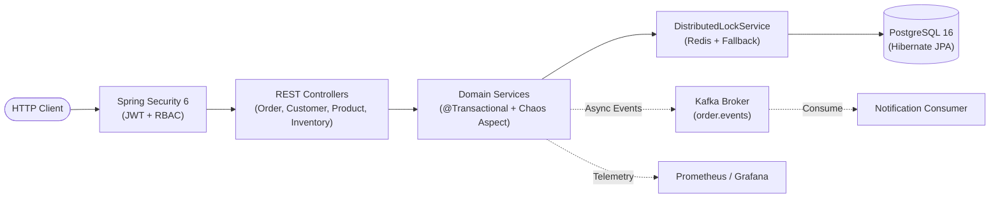

# EOPIS — Enterprise Order, Payment & Inventory System

## Production-Ready Java, Spring Boot & Hibernate Real-Time Debugging Laboratory

[](https://github.com/rohitlavate97/java-spring-debugging/actions/workflows/ci.yml)
[](https://openjdk.org/)
[](https://spring.io/projects/spring-boot)
[](https://www.docker.com/)
[](https://www.postgresql.org/)
[](https://redis.io/)
[-black.svg)](https://kafka.apache.org/)
[](LICENSE)

---

## Table of Contents

- [1. System Overview & Purpose](#1-system-overview--purpose)
  - [Container & Debugger Topology](#container--debugger-topology)
  - [Architectural Request Flow](#architectural-request-flow)
- [2. Technology Stack](#2-technology-stack)
- [3. Port Mappings & Service Directory](#3-port-mappings--service-directory)
- [4. Domain-Modular Monolith Architecture](#4-domain-modular-monolith-architecture)
- [5. Quick Start & Execution](#5-quick-start--execution)
  - [Prerequisites](#prerequisites)
  - [Running the Full Stack (Docker Compose)](#running-the-full-stack-docker-compose)
  - [Running Locally (Maven Wrapper)](#running-locally-maven-wrapper)
- [6. IntelliJ IDEA Debugging Workflow](#6-intellij-idea-debugging-workflow)
  - [Attaching to the Running Docker Container](#attaching-to-the-running-docker-container)
  - [Core Debugging Techniques Practiced](#core-debugging-techniques-practiced)
- [7. Bug Injection System (Chaos Engineering)](#7-bug-injection-system-chaos-engineering)
- [8. Documentation Knowledge Base Directory](#8-documentation-knowledge-base-directory)
- [9. Testing & Quality Assurance](#9-testing--quality-assurance)
- [10. License](#10-license)

---

## 1. System Overview & Purpose

**EOPIS (Enterprise Order, Payment & Inventory System)** is an enterprise-grade modular monolith engineered to simulate a live, highly concurrent production e-commerce platform while functioning as a real-time debugging laboratory.

Rather than reading static code snippets, engineers attach **IntelliJ IDEA's interactive debugger to live, continuously-running Docker containers**, observe telemetry in **Grafana**, inspect relational database locks in **PostgreSQL / pgAdmin**, trace asynchronous event streams in **Kafka UI**, and systematically diagnose production failure modes.

### Container & Debugger Topology

```text
                          ┌─────────────────────────────┐
                          │   IntelliJ IDEA Debugger    │
                          │   (Attaches via JDWP 5005)  │
                          └──────────────┬──────────────┘
                                         │ (JDWP Socket)
                                         ▼
┌─────────────────────────────────────────────────────────────────────────────┐
│ docker-compose.yml (Local Production-like Stack):                           │
│                                                                             │
│   ┌─────────────────────────────────────────────────────────────────────┐   │
│   │  eopis-app (Spring Boot 3.4.2, JVM Debug Exposed on Port 5005)      │   │
│   │       │                    │                    │                   │   │
│   │       ▼                    ▼                    ▼                   │   │
│   │  PostgreSQL 16        Redis 7.x           Kafka 3.7 (KRaft)         │   │
│   │  (+ pgAdmin 4)       (Cache, Lock)       (+ Kafka-UI)               │   │
│   │       │                                                             │   │
│   │       ▼                                                             │   │
│   │  Prometheus + Grafana (Live Metrics & Pre-Provisioned Dashboards)   │   │
│   │       │                                                             │   │
│   │       ▼                                                             │   │
│   │  Structured ECS Logs (MDC Correlation & Request IDs)                │   │
│   └─────────────────────────────────────────────────────────────────────┘   │
└─────────────────────────────────────────────────────────────────────────────┘
```

### Architectural Request Flow



---

## 2. Technology Stack

- **Core Framework**: Java 21 LTS, Spring Boot 3.4.2, Spring MVC, Spring Data JPA (Hibernate 6.6)
- **Security & Identity**: Spring Security 6, JJWT 0.12.6 (Stateless Bearer Tokens, Role-Based Access Control)
- **Database & Migrations**: PostgreSQL 16 (Alpine), Flyway Database Migrations
- **Distributed Caching & Locking**: Redis 7 (Alpine), Spring Cache (`@Cacheable`, `@CacheEvict`), Redis Distributed Locks with local fallback
- **Event-Driven Messaging**: Apache Kafka 3.7 (KRaft Mode without ZooKeeper), Spring Kafka Producer/Consumer, Kafka-UI
- **Observability & Metrics**: Spring Boot Actuator, Micrometer Prometheus Registry, Prometheus, Grafana 11
- **Structured Logging**: Elastic Common Schema (ECS) JSON format, SLF4J MDC Correlation Tracking
- **Automated Testing**: JUnit 5, Mockito, AssertJ, Spring MockMvc, Testcontainers PostgreSQL

---

## 3. Port Mappings & Service Directory

When the stack is started, the following services are available:

| Service | Host URL / Port | Credentials / Purpose |
| :--- | :--- | :--- |
| **EOPIS Application API** | `http://localhost:8080` | Spring Boot REST API & Swagger UI |
| **Remote JVM Debug** | `localhost:5005` | JDWP debug socket for IntelliJ IDEA Attach to Process |
| **Actuator Health Probe** | `http://localhost:8080/actuator/health` | Application & dependency liveness/readiness probes |
| **Chaos Runtime Toggles** | `http://localhost:8080/actuator/chaos` | View and verify active runtime chaos fault injection flags |
| **pgAdmin 4** | `http://localhost:5050` | `admin@eopis.local` / `admin` (PostgreSQL GUI inspection) |
| **PostgreSQL Database** | `localhost:5432` | `eopis_user` / `eopis_password` (Database: `eopis_db`) |
| **Redis Cache & Locks** | `localhost:6379` | In-memory distributed caching and concurrency locks |
| **Kafka UI Console** | `http://localhost:8085` | Live topic inspection, partition lag, and event viewer |
| **Prometheus Telemetry** | `http://localhost:9090` | Scrapes Actuator metrics every 5 seconds |
| **Grafana Dashboards** | `http://localhost:3000` | `admin` / `admin` (Pre-provisioned JVM, HikariCP, and HTTP dashboards) |

---

## 4. Domain-Modular Monolith Architecture

The codebase strictly follows a **domain-modular monolith** design under the `com.eopis` root package:

```text
com.eopis
├── EopisApplication.java                     # Application Entry Point
│
├── common                                    # Cross-Cutting Infrastructure
│   ├── chaos/                                # ChaosProperties, ChaosFaultInjectorAspect, ChaosEndpoint
│   ├── config/                               # SecurityConfig, RedisConfig, WebMvcConfig, DataSeeder
│   ├── exception/                            # GlobalExceptionHandler, DomainException
│   ├── lock/                                 # DistributedLockService (Redis with In-Memory Fallback)
│   ├── logging/                              # CorrelationIdFilter (MDC tracking for correlation_id)
│   ├── metrics/                              # EopisMetricsService (Micrometer Custom Counters)
│   └── security/                             # JwtTokenProvider, JwtAuthenticationFilter, UserDetailsService
│
├── customer                                  # Customer Entities, DTOs, Service & CustomerController
├── product                                   # Product & Category Entities, Redis @Cacheable ProductService
├── inventory                                 # Warehouse, Stock, Optimistic Locking & InventoryController
├── order                                     # Order, PricingService, Kafka Publisher & OrderController
├── payment                                   # Payment Transactions, Refunds, Idempotency & PaymentController
├── shipment                                  # Shipment Entities, Tracking History & ShipmentService
├── notification                              # NotificationLog Entity & NotificationKafkaConsumer
├── audit                                     # AuditLog Entity, Repository & AuditService
└── security                                  # User, Role, Permission Entities & AuthController (/api/auth)
```

---

## 5. Quick Start & Execution

### Prerequisites
- **JDK 21+** (e.g. [Eclipse Adoptium Temurin 21+](https://adoptium.net/))
- **Git 2.40+**
- **Docker Desktop** or **OrbStack** (with Docker Compose v2)

### Running the Full Stack (Docker Compose)

```bash
# 1. Clone the repository
git clone https://github.com/rohitlavate97/java-spring-debugging.git
cd java-spring-debugging

# 2. Start all services in background
docker compose up -d

# 3. Verify all 8 containers are healthy
docker compose ps

# 4. View live structured ECS JSON logs
docker compose logs -f eopis-app
```

> [!TIP]
> See the complete setup manual in [LOCAL_SETUP.md](LOCAL_SETUP.md) for detailed configuration, pgAdmin connections, and troubleshooting tips.

### Running Locally (Maven Wrapper)

```bash
# macOS / Linux: Execute test suite
./mvnw clean test

# macOS / Linux: Run application locally
./mvnw spring-boot:run
```

```powershell
# Windows (PowerShell): Execute test suite
.\mvnw.cmd clean test

# Windows (PowerShell): Run application locally
.\mvnw.cmd spring-boot:run
```

---

## 6. IntelliJ IDEA Debugging Workflow

### Attaching to the Running Docker Container

1. In IntelliJ IDEA, go to **Run → Edit Configurations...**
2. Click **+ → Remote JVM Debug**.
3. Set **Name**: `EOPIS Docker Container (Port 5005)`.
4. Set **Host**: `localhost`, **Port**: `5005`.
5. Set **Use module classpath**: `eopis-app`.
6. Click **Debug** (`Shift+F9`). IntelliJ will attach to the JVM running inside the container.

### Core Debugging Techniques Practiced

- **Breakpoints**: Line, Method, Exception Breakpoints, and Conditional Breakpoints (e.g., break only when `order.getTotalAmount().compareTo(BigDecimal.valueOf(1000)) > 0`).
- **Execution Flow**: Step Over (`F8`), Step Into (`F7`), Force Step Into, Step Out (`Shift+F8`), Run to Cursor (`Alt+F9`).
- **State Inspection**: Variables view, Watches, and **Evaluate Expression (`Alt+F8`)**.
- **Thread Inspection**: Inspect thread states (`RUNNABLE`, `WAITING`, `BLOCKED`) and locks during concurrent order processing.
- **Log Correlation**: Correlate MDC `correlation_id` across HTTP requests and Kafka consumers.

---

## 7. Bug Injection System (Chaos Engineering)

Bugs in EOPIS are implemented as **toggleable runtime faults** via Spring `@ConfigurationProperties` and AOP (`ChaosFaultInjectorAspect`) rather than disposable one-shot code modifications:

```yaml
eopis:
  chaos:
    enabled: true
    faults:
      payment-intermittent-failure:
        enabled: true
        failure-rate-percent: 1.5
      inventory-lock-contention:
        enabled: true
        latency-ms: 350
      order-placement-slowdown:
        enabled: false
        latency-ms: 500
```

- **Inspect Active Chaos Flags**: `GET http://localhost:8080/actuator/chaos`
- **Activate Chaos Profile**: Pass `--spring.profiles.active=chaos` on startup.

---

## 8. Documentation Knowledge Base Directory

The repository includes a comprehensive, enterprise-grade documentation suite:

| Document | Purpose & Target Scope | Key Contents |
| :--- | :--- | :--- |
| **[`LOCAL_SETUP.md`](LOCAL_SETUP.md)** | Local Environment Setup Guide | Step-by-step onboarding, Docker commands, IntelliJ JDWP setup, pgAdmin guide |
| **[`docs/ARCHITECTURE.md`](docs/ARCHITECTURE.md)** | System Architecture Reference | Request lifecycle flowchart, Mermaid ER diagram, package layout, observability |
| **[`docs/STATE.md`](docs/STATE.md)** | System State & Runtime Dashboard | Current release phase, active chaos flags matrix, test breakdown, container health |
| **[`audit.md`](audit.md)** | Technical Project Audit & Remediation Log | Formal audit against specification, remediation commit details, compliance scorecard |
| **[`enterprise-java-debugging-lab-master-prompt.md`](enterprise-java-debugging-lab-master-prompt.md)** | Master Curriculum Specification | 10 non-negotiable rules, 32 syllabus modules, 7 difficulty tiers, evaluation rubric |
| **[`docs/bugs/BUG-001-immutable-bigdecimal-subtotal.md`](docs/bugs/BUG-001-immutable-bigdecimal-subtotal.md)** | Incident Post-Mortem (BUG-001) | Full analysis of immutable `BigDecimal` return value discard, IntelliJ walkthrough |
| **[`docs/debugging-reports/REPORT-001-bigdecimal-subtotal.md`](docs/debugging-reports/REPORT-001-bigdecimal-subtotal.md)** | Scored Evaluation Report (BUG-001) | 4-dimension rubric scoring (100% Pass / Grade: Senior), evaluator commentary |

---

## 9. Testing & Quality Assurance

The automated test suite verifies 24 tests across 14 integration test classes:

```bash
# Execute complete unit and integration test suite
./mvnw clean test
```

| Test Class | Focus Area | Status |
| :--- | :--- | :---: |
| `SecurityIntegrationTest` | JWT authentication and RBAC endpoint authorization | ✅ PASS |
| `OrderControllerIntegrationTest` | Order REST API endpoints, DTO validation, and transactions | ✅ PASS |
| `OrderPricingServiceTest` | Pricing calculation, tiered discounts, tax, and BigDecimal fix | ✅ PASS |
| `ConcurrentOrderPlacementTest` | Multi-threaded concurrency and oversell race protection | ✅ PASS |
| `ProductCacheIntegrationTest` | Redis `@Cacheable` caching and `@CacheEvict` invalidation | ✅ PASS |
| `OrderEventIntegrationTest` | Apache Kafka `OrderPlacedEvent` producer and notification listener | ✅ PASS |
| `PaymentServiceChaosTest` | AOP chaos fault injection and intermittent failure simulation | ✅ PASS |
| `MetricsAndLoggingTest` | MDC correlation tracking and custom Micrometer counters | ✅ PASS |
| `FlywayPostgresMigrationIntegrationTest` | PostgreSQL schema validation via Testcontainers | 🟡 DOCKER |

---

## 10. License

This project is licensed under the [MIT License](LICENSE).
