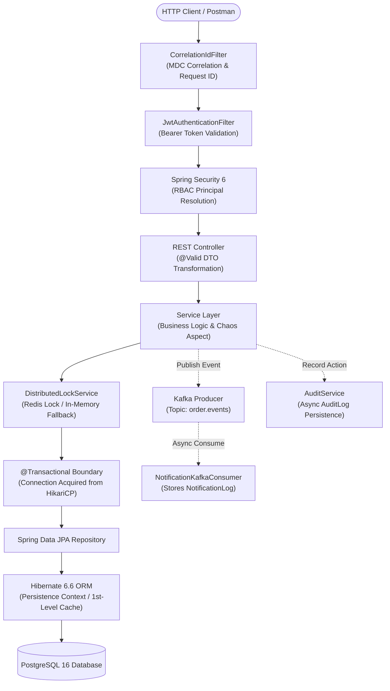
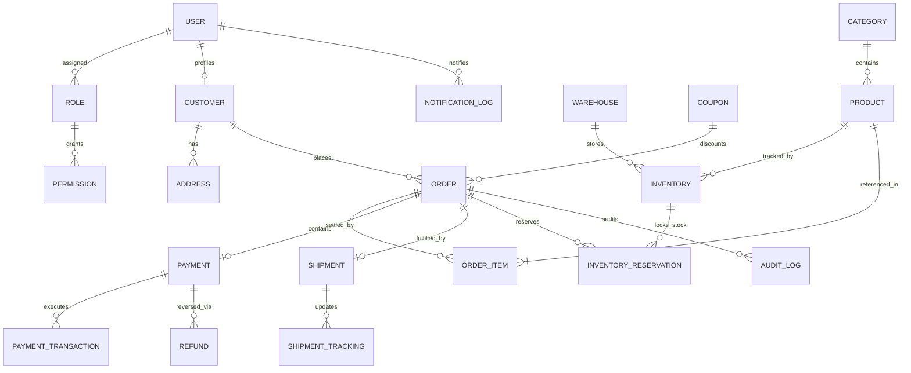

# EOPIS System Architecture & Technical Specification

[](#1-system-overview)
[](https://openjdk.org/)
[](https://spring.io/projects/spring-boot)
[](https://hibernate.org/)
[](#8-implementation-status--verification-matrix)

> **Navigation**: [Home](../README.md) / [Local Environment Setup](../LOCAL_SETUP.md) / **Architecture Reference** / [System State](STATE.md) / [Audit Report](../audit.md) / [Bug Logs](bugs/BUG-001-immutable-bigdecimal-subtotal.md)

---

## Table of Contents

- [1. System Overview](#1-system-overview)
  - [Architectural Topology](#architectural-topology)
  - [End-to-End Request Lifecycle](#end-to-end-request-lifecycle)
- [2. Domain-Modular Monolith Architecture](#2-domain-modular-monolith-architecture)
  - [Package Layout & Bounded Contexts](#package-layout--bounded-contexts)
  - [Subsystem Responsibilities](#subsystem-responsibilities)
- [3. Domain Entity & Relational Data Model](#3-domain-entity--relational-data-model)
  - [Entity-Relationship Diagram](#entity-relationship-diagram)
  - [Core Domain Entities & Schema Definition](#core-domain-entities--schema-definition)
- [4. Database & Flyway Migration Strategy](#4-database--flyway-migration-strategy)
- [5. Bug Injection Subsystem (Chaos Engineering)](#5-bug-injection-subsystem-chaos-engineering)
- [6. Observability, Metrics & Structured Logging](#6-observability-metrics--structured-logging)
  - [ECS-Compliant JSON Structured Logging](#ecs-compliant-json-structured-logging)
  - [Prometheus Metrics & Grafana Dashboards](#prometheus-metrics--grafana-dashboards)
- [7. Module Debugging Matrix](#7-module-debugging-matrix)
- [8. Implementation Status & Verification Matrix](#8-implementation-status--verification-matrix)

---

## 1. System Overview

**EOPIS (Enterprise Order, Payment & Inventory System)** is an enterprise-grade modular monolith built on **Java 21+** and **Spring Boot 3.4.2**. It simulates a high-throughput, highly concurrent e-commerce production platform while functioning as a real-time debugging laboratory.

Engineers attach IntelliJ IDEA's interactive debugger to live, continuously-running Docker containers over JDWP (port 5005), observing real-time telemetry across PostgreSQL, Redis, Kafka, Prometheus, and Grafana.

### Architectural Topology

```text
                          ┌─────────────────────────────┐
                          │   IntelliJ IDEA Debugger    │
                          │   (Attaches via JDWP 5005)  │
                          └──────────────┬──────────────┘
                                         │
                                         ▼
┌─────────────────────────────────────────────────────────────────────────────┐
│ Docker Compose Network (eopis-network)                                      │
│                                                                             │
│   ┌─────────────────────────────────────────────────────────────────────┐   │
│   │  eopis-app (Spring Boot 3.4.2 / Eclipse Temurin 21)                 │   │
│   │  • HTTP REST API (Port 8080)                                        │   │
│   │  • Remote JVM Debug Socket (Port 5005)                              │   │
│   │  • Actuator & Custom Chaos Endpoints (/actuator/chaos)              │   │
│   │  • Micrometer Prometheus Scrape Target (/actuator/prometheus)       │   │
│   └──────┬───────────────┬────────────────┬───────────────┬─────────────┘   │
│          │               │                │               │                 │
│          ▼               ▼                ▼               ▼                 │
│   ┌─────────────┐ ┌─────────────┐  ┌─────────────┐ ┌─────────────┐          │
│   │ PostgreSQL  │ │    Redis    │  │ Apache Kafka│ │ Prometheus  │          │
│   │  16-alpine  │ │  7-alpine   │  │ 3.7 (KRaft) │ │  Scraper    │          │
│   │ (Port 5432) │ │ (Port 6379) │  │ (Port 9092) │ │ (Port 9090) │          │
│   └──────┬──────┘ └─────────────┘  └──────┬──────┘ └──────┬──────┘          │
│          │                                │               │                 │
│          ▼                                ▼               ▼                 │
│   ┌─────────────┐                  ┌─────────────┐ ┌─────────────┐          │
│   │   pgAdmin   │                  │  Kafka-UI   │ │   Grafana   │          │
│   │ 4 (Web UI)  │                  │ (Dashboard) │ │ Dashboards  │          │
│   │ (Port 5050) │                  │ (Port 8085) │ │ (Port 3000) │          │
│   └─────────────┘                  └─────────────┘ └─────────────┘          │
└─────────────────────────────────────────────────────────────────────────────┘
```

### End-to-End Request Lifecycle

The request lifecycle trains engineers to observe state propagation through every layer of the enterprise Spring Boot stack:



---

## 2. Domain-Modular Monolith Architecture

The application strictly enforces **domain-modular boundaries** under `com.eopis` to avoid monolithic coupling, circular dependencies, and architectural drift.

### Package Layout & Bounded Contexts

```text
com.eopis
├── EopisApplication.java                     # Spring Boot Main Entry Point
│
├── common                                    # Cross-Cutting Core Capabilities
│   ├── chaos/                                # Runtime Fault Injector & Chaos Endpoint
│   ├── config/                               # Security, Redis, WebMvc, DataSeeder Configuration
│   ├── exception/                            # GlobalExceptionHandler & Custom Domain Exceptions
│   ├── lock/                                 # Redis DistributedLockService with Local Fallback
│   ├── logging/                              # CorrelationIdFilter (MDC tracking: correlation_id)
│   ├── metrics/                              # EopisMetricsService (Micrometer Custom Counters)
│   └── security/                             # JwtTokenProvider, JwtAuthFilter, UserDetailsService
│
├── customer                                  # Customer Management Domain
│   ├── controller/                           # CustomerController (REST Endpoints)
│   ├── dto/                                  # CustomerRequestDto, CustomerResponseDto
│   ├── entity/                               # Customer, Address
│   ├── repository/                           # CustomerRepository, AddressRepository
│   └── service/                              # CustomerService, CustomerServiceImpl
│
├── product                                   # Catalog & Product Domain
│   ├── controller/                           # ProductController (REST Endpoints)
│   ├── dto/                                  # ProductRequestDto, ProductResponseDto
│   ├── entity/                               # Product, Category
│   ├── repository/                           # ProductRepository, CategoryRepository
│   └── service/                              # ProductService (@Cacheable Redis Integration)
│
├── inventory                                 # Stock & Warehouse Domain
│   ├── controller/                           # InventoryController (REST Endpoints)
│   ├── dto/                                  # StockReservationDto, InventoryResponseDto
│   ├── entity/                               # Warehouse, Inventory, InventoryReservation
│   ├── repository/                           # WarehouseRepository, InventoryRepository, ReservationRepository
│   └── service/                              # InventoryService (Optimistic Locking & Concurrency)
│
├── order                                     # Order Orchestration & Pricing Domain
│   ├── controller/                           # OrderController (REST Endpoints)
│   ├── dto/                                  # OrderCreateRequestDto, OrderResponseDto
│   ├── entity/                               # Order, OrderItem, Coupon
│   ├── event/                                # OrderPlacedEvent, OrderEventPublisher
│   ├── repository/                           # OrderRepository, OrderItemRepository, CouponRepository
│   └── service/                              # OrderService, OrderPricingService
│
├── payment                                   # Financial Settlement & Refunds Domain
│   ├── controller/                           # PaymentController (REST Endpoints)
│   ├── dto/                                  # PaymentRequestDto, PaymentResponseDto
│   ├── entity/                               # Payment, PaymentTransaction, Refund
│   ├── repository/                           # PaymentRepository, PaymentTransactionRepository, RefundRepository
│   └── service/                              # PaymentService, PaymentServiceImpl
│
├── shipment                                  # Fulfillment & Logistics Domain
│   ├── entity/                               # Shipment, ShipmentTracking
│   ├── repository/                           # ShipmentRepository, ShipmentTrackingRepository
│   └── service/                              # ShipmentService, ShipmentServiceImpl
│
├── notification                              # Asynchronous Messaging Domain
│   ├── consumer/                             # NotificationKafkaConsumer (Kafka Listener)
│   ├── entity/                               # NotificationLog
│   └── repository/                           # NotificationLogRepository
│
├── audit                                     # Security & Audit Trail Domain
│   ├── entity/                               # AuditLog (UUID Keyed, Correlation Tracked)
│   ├── repository/                           # AuditLogRepository
│   └── service/                              # AuditService, AuditServiceImpl
│
└── security                                  # User Identity & RBAC Domain
    ├── controller/                           # AuthController (/api/auth/login, /api/auth/register)
    ├── dto/                                  # AuthRequest, AuthResponse
    ├── entity/                               # User, Role, Permission
    └── repository/                           # UserRepository, RoleRepository, PermissionRepository
```

### Subsystem Responsibilities

| Subsystem | Primary Responsibilities | Key Technologies |
| :--- | :--- | :--- |
| **`common`** | Security filters, Redis locks, MDC correlation, Micrometer metrics, Chaos engine | Spring AOP, Redis, JJWT, SLF4J MDC |
| **`customer`** | Customer profiling, VIP tier assignment, multiple shipping/billing addresses | Spring Data JPA, Hibernate Lazy Loading |
| **`product`** | Catalog browsing, category hierarchies, cached price queries | Spring Cache (`@Cacheable`), Redis |
| **`inventory`** | Warehouse stock tracking, concurrent reservations, oversell prevention | `@Version` Optimistic Locking, Redis Locks |
| **`order`** | Order placement, item calculation, pricing rules, transactional orchestration | `@Transactional`, Spring Kafka Publisher |
| **`payment`** | Idempotent transaction execution, payment settlement, refund processing | Idempotency Keys, AOP Fault Injection |
| **`shipment`** | Carrier dispatch, delivery tracking history, dispatch status machine | Spring Data JPA, Status Transitions |
| **`notification`**| Asynchronous event consumption, notification delivery logging | Spring Kafka (`@KafkaListener`) |
| **`audit`** | Tamper-evident logging of administrative actions with correlation IDs | Asynchronous Repository, JSON State |
| **`security`** | Authentication, JWT token issuance, RBAC permission resolution | Spring Security 6, BCrypt, JJWT |

---

## 3. Domain Entity & Relational Data Model

### Entity-Relationship Diagram



### Core Domain Entities & Schema Definition

#### 1. Identity & Customer Entities
- **`User`** (`users`): `id` (UUID, PK), `username` (Unique), `email` (Unique), `password_hash`, `status`, `created_at`, `version` (Long).
- **`Role`** & **`Permission`**: Standard RBAC tables with join tables `users_roles` and `roles_permissions`.
- **`Customer`** (`customers`): `id` (Long, PK), `user_id` (UUID, FK), `customer_number` (`CUST-XXXX`), `first_name`, `last_name`, `email`, `phone`, `tier` (`REGULAR`, `VIP`, `ENTERPRISE`).
- **`Address`** (`addresses`): `id` (Long, PK), `customer_id` (FK), `street`, `city`, `state`, `postal_code`, `country`, `is_default_billing`, `is_default_shipping`.

#### 2. Catalog & Stock Entities
- **`Category`** (`categories`): `id` (Long, PK), `name`, `code`, `parent_id` (Self FK for hierarchical navigation).
- **`Product`** (`products`): `id` (Long, PK), `sku` (Unique, e.g. `PROD-381`), `name`, `description`, `price` (Numeric 12,2), `currency`, `category_id` (FK), `status` (`ACTIVE`, `DISCONTINUED`), `version` (Long).
- **`Warehouse`** (`warehouses`): `id` (Long, PK), `code` (`WH-17`), `name`, `location_address`, `is_active`.
- **`Inventory`** (`inventories`): `id` (Long, PK), `warehouse_id` (FK), `product_id` (FK), `quantity_available` (Int), `quantity_allocated` (Int), `reorder_threshold` (Int), `version` (Long).
- **`InventoryReservation`** (`inventory_reservations`): `id` (UUID, PK), `order_id` (FK), `inventory_id` (FK), `quantity` (Int), `status` (`PENDING`, `CONFIRMED`, `RELEASED`, `EXPIRED`), `expires_at` (Timestamp).

#### 3. Order & Pricing Entities
- **`Order`** (`orders`): `id` (Long, PK), `order_number` (Unique, `ORD-XXXXXX`), `customer_id` (FK), `status` (`PENDING`, `CONFIRMED`, `PAID`, `PROCESSING`, `SHIPPED`, `DELIVERED`, `CANCELLED`), `subtotal_amount`, `discount_amount`, `tax_amount`, `shipping_amount`, `total_amount`, `coupon_id` (FK nullable), `version` (Long), timestamps.
- **`OrderItem`** (`order_items`): `id` (Long, PK), `order_id` (FK), `product_id` (FK), `quantity` (Int), `unit_price`, `total_price`.
- **`Coupon`** (`coupons`): `id` (Long, PK), `code` (Unique), `discount_type` (`PERCENTAGE`, `FIXED`), `discount_value`, `min_order_value`, `max_discount`, `usage_limit`, `used_count`, `valid_from`, `valid_to`, `is_active`.

#### 4. Payment & Fulfillment Entities
- **`Payment`** (`payments`): `id` (Long, PK), `payment_number` (`PAY-XXXXXX`), `order_id` (FK), `customer_id` (FK), `amount`, `status` (`INITIATED`, `SUCCESS`, `FAILED`, `REFUNDED`), `gateway_reference`, `version` (Long).
- **`PaymentTransaction`** (`payment_transactions`): `id` (UUID, PK), `payment_id` (FK), `type` (`AUTH`, `CAPTURE`, `REFUND`), `amount`, `status`, `idempotency_key` (Unique), `gateway_reference`.
- **`Refund`** (`refunds`): `id` (Long, PK), `payment_id` (FK), `amount`, `reason`, `status`, `created_at`.
- **`Shipment`** (`shipments`): `id` (Long, PK), `shipment_number`, `order_id` (FK), `carrier` (`FEDEX`, `UPS`, `DHL`), `tracking_number`, `status`.
- **`ShipmentTracking`** (`shipment_tracking`): `id` (Long, PK), `shipment_id` (FK), `status`, `location`, `description`, `timestamp`.

#### 5. Audit & Telemetry Entities
- **`AuditLog`** (`audit_logs`): `id` (UUID, PK), `principal`, `action`, `resource_type`, `resource_id`, `details`, `ip_address`, `correlation_id`, `created_at`.
- **`NotificationLog`** (`notification_logs`): `id` (UUID, PK), `recipient`, `channel` (`EMAIL`, `SMS`, `KAFKA`), `message`, `status`, `correlation_id`, `sent_at`.

---

## 4. Database & Flyway Migration Strategy

- **RDBMS Engine**: PostgreSQL 16 (running via container with Alpine base)
- **Migration Framework**: Flyway
- **Baseline Migration Script**: [`src/main/resources/db/migration/V1__init_schema.sql`](../src/main/resources/db/migration/V1__init_schema.sql)
- **Schema Validation in CI / Tests**:
  - `application-test.yml` uses in-memory H2 for rapid local unit testing (`ddl-auto: create-drop`).
  - [`FlywayPostgresMigrationIntegrationTest.java`](../src/test/java/com/eopis/migration/FlywayPostgresMigrationIntegrationTest.java) verifies complete schema execution against real PostgreSQL via Testcontainers.

> [!IMPORTANT]
> All schema modifications must be introduced through sequential Flyway migrations (`V2__...`, `V3__...`). Direct manual modifications to production database tables are strictly forbidden.

---

## 5. Bug Injection Subsystem (Chaos Engineering)

To simulate live production failures without destructive code edits, EOPIS implements a toggleable **Chaos Subsystem**:

```yaml
eopis:
  chaos:
    enabled: true
    faults:
      payment-intermittent-failure:
        enabled: true
        failure-rate-percent: 1.5
      inventory-lock-contention:
        enabled: true
        latency-ms: 350
      order-placement-slowdown:
        enabled: false
        latency-ms: 500
```

### Chaos Engineering Architecture

1. **`ChaosProperties`**: Binds strongly-typed properties under `eopis.chaos.*`.
2. **`ChaosFaultInjectorAspect`**: Spring AOP `@Around` aspect scoped to intercept target service calls (`PaymentService`, `InventoryService`, `OrderService`).
3. **`ChaosEndpoint` (`GET /actuator/chaos`)**: Exposes active runtime faults dynamically:
   ```json
   {
     "chaosEnabled": true,
     "activeFaults": {
       "payment-intermittent-failure": {
         "enabled": true,
         "failureRatePercent": 1.5
       },
       "inventory-lock-contention": {
         "enabled": true,
         "latencyMs": 350
       }
     }
   }
   ```

---

## 6. Observability, Metrics & Structured Logging

### ECS-Compliant JSON Structured Logging

Every incoming HTTP request or Kafka message passes through `CorrelationIdFilter`, populating SLF4J MDC with:
- `correlation_id` (retained across asynchronous events and downstream operations)
- `request_id` (unique to the immediate HTTP call)

Spring Boot 3.4.2 structured logging format is set to **Elastic Common Schema (ECS)**:

```json
{
  "@timestamp": "2026-10-31T10:10:29.838Z",
  "log.level": "INFO",
  "process.pid": 45577,
  "process.thread.name": "http-nio-8080-exec-2",
  "service.name": "eopis-app",
  "log.logger": "com.eopis.order.service.OrderServiceImpl",
  "message": "Processing order placement for Customer ID: 1",
  "correlation_id": "c7a8b9e1-2345-6789-abcd-ef0123456789",
  "ecs.version": "8.11"
}
```

### Prometheus Metrics & Grafana Dashboards

- **Scrape Endpoint**: `GET http://localhost:8080/actuator/prometheus` (scraped every 5s by Prometheus)
- **Pre-Provisioned Dashboards**: Available at `http://localhost:3000` (`admin` / `admin`)
  - **JVM Telemetry**: Heap memory usage, GC pause duration, thread counts (`RUNNABLE`, `BLOCKED`, `WAITING`)
  - **HikariCP Connection Pool**: Active vs idle connections, pending threads, acquire latency
  - **HTTP Server Metrics**: `http.server.requests` percentile distribution (P50, P95, P99)
  - **Custom Business Telemetry**:
    - `eopis.orders.placed.total`: Real-time order placement velocity
    - `eopis.payments.failed.total`: Failed transaction monitoring
    - `eopis.inventory.lock.contention`: Lock acquisition contention counter

---

## 7. Module Debugging Matrix

Each domain module is structured to provide specific target debugging scenarios across progressive skill levels:

| Subsystem | Primary Debugging Learning Objectives & Scenarios |
| :--- | :--- |
| **`customer`** | • `LazyInitializationException` on un-fetched address collections<br>• DTO circular reference serialization loops<br>• Spring Security principal resolution inspection via breakpoints |
| **`product`** | • N+1 query problem when loading hierarchical category products<br>• First-level vs Redis 2nd-level cache invalidation anomalies<br>• Dirty checking leading to unintended `UPDATE` queries |
| **`inventory`** | • Concurrency race conditions: overselling stock under multi-threaded load<br>• Optimistic locking collisions (`@Version` / `StaleObjectStateException`)<br>• Distributed lock release timeouts and Redis connection fallbacks |
| **`order`** | • Self-invocation `@Transactional` proxy bypass defects<br>• Checked vs unchecked exception rollback rules<br>• Arithmetic value discard on immutable `BigDecimal` ([BUG-001](bugs/BUG-001-immutable-bigdecimal-subtotal.md)) |
| **`payment`** | • Idempotency key duplicate request race conditions<br>• Probabilistic AOP chaos gateway failures (1.5% intermittent failures)<br>• Partial refund ledger inconsistencies across transactional boundaries |
| **`shipment`** | • Asynchronous event ordering anomalies (`ShipmentCreated` before `OrderPaid`)<br>• Kafka consumer deserialization dead-letter queue failures<br>• Unbounded batch query memory pressure and heap exhaustion |
| **`security`** | • Expired JWT token handling & subtle role hierarchy authorization 403s<br>• Security filter chain ordering defects & ThreadLocal security context leakage |
| **`common/chaos`**| • Live container JVM debugging via port 5005<br>• Thread dump analysis for simulated deadlocks and lock contention |

---

## 8. Implementation Status & Verification Matrix

| Architecture Component | Target Specification | Current Status | Verification Test Class |
| :--- | :--- | :---: | :--- |
| **Domain Monolith Core** | 8 Domain Modules fully implemented | ✅ COMPLETE | All 14 Test Suites |
| **REST API Layer** | Full HTTP Controllers for all business domains | ✅ COMPLETE | `OrderControllerIntegrationTest`, `CustomerControllerIntegrationTest` |
| **Security & RBAC** | Stateless JWT, BCrypt, Filter Chain, Roles/Permissions | ✅ COMPLETE | `SecurityIntegrationTest` |
| **Relational Schema** | Flyway V1 migration matches 19 JPA entities | ✅ COMPLETE | `FlywayPostgresMigrationIntegrationTest` |
| **Caching & Locking** | Redis Cacheable + DistributedLockService with local fallback | ✅ COMPLETE | `ProductCacheIntegrationTest`, `ConcurrentOrderPlacementTest` |
| **Event Streaming** | Apache Kafka (KRaft) Producer & Consumer Notification | ✅ COMPLETE | `OrderEventIntegrationTest` |
| **Observability Stack** | Prometheus 5s scrape, Grafana dashboards, ECS JSON logs | ✅ COMPLETE | `MetricsAndLoggingTest`, `ActuatorHealthEndpointTest` |
| **Chaos Fault System** | Dynamic AOP injection, `application-chaos.yml`, Actuator endpoint | ✅ COMPLETE | `PaymentServiceChaosTest` |

---

## Related References

- [Master Project README](../README.md)
- [Local Setup & IDE Walkthrough](../LOCAL_SETUP.md)
- [System State Tracker](STATE.md)
- [Audit Remediation Report](../audit.md)
- [BUG-001 Incident Post-Mortem](bugs/BUG-001-immutable-bigdecimal-subtotal.md)
